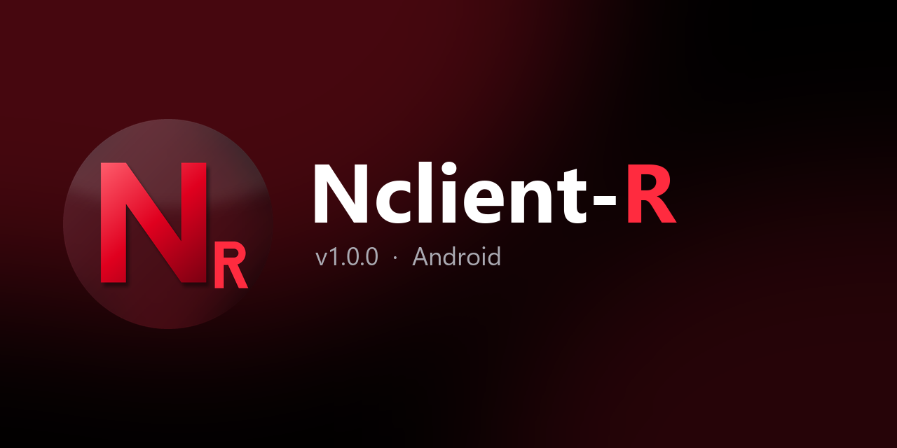
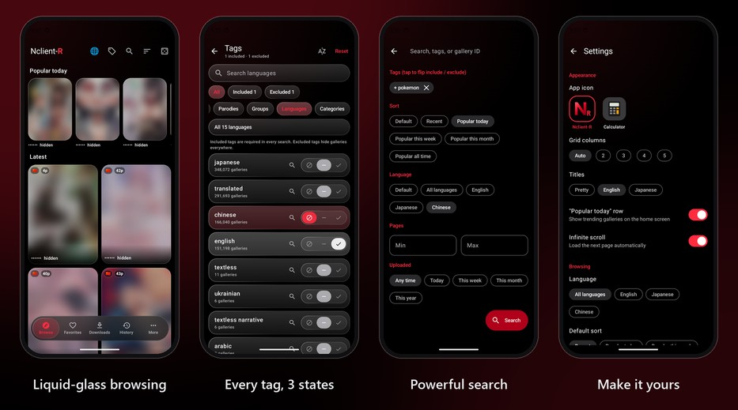
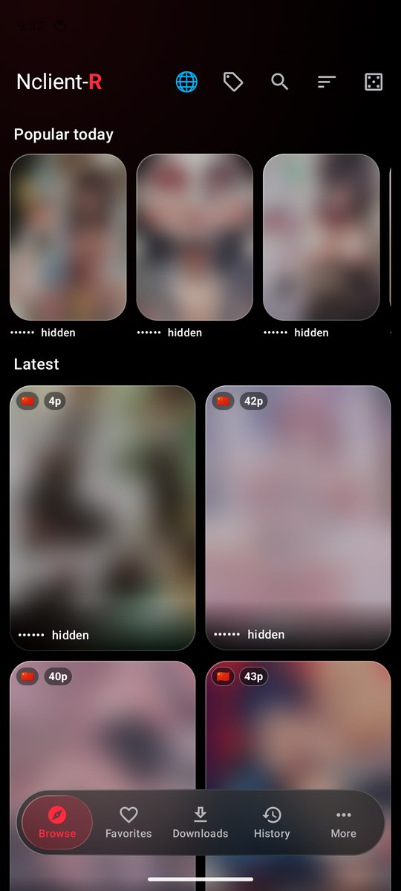
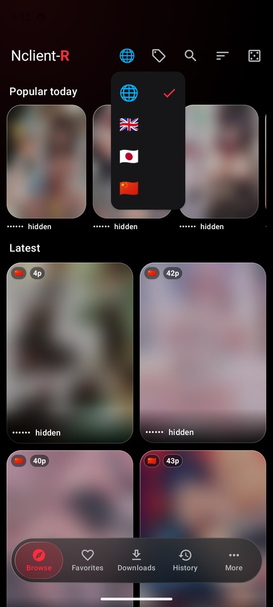
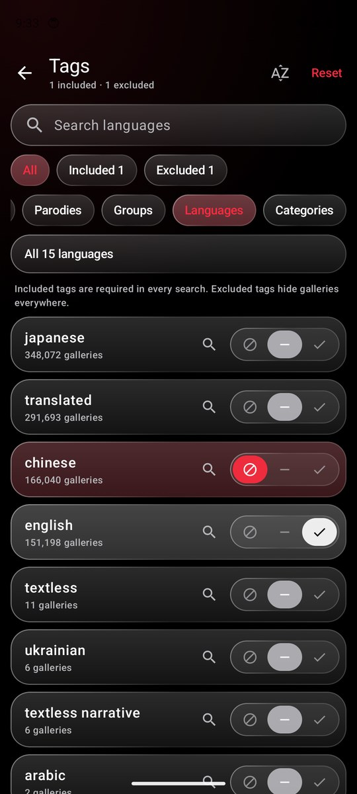
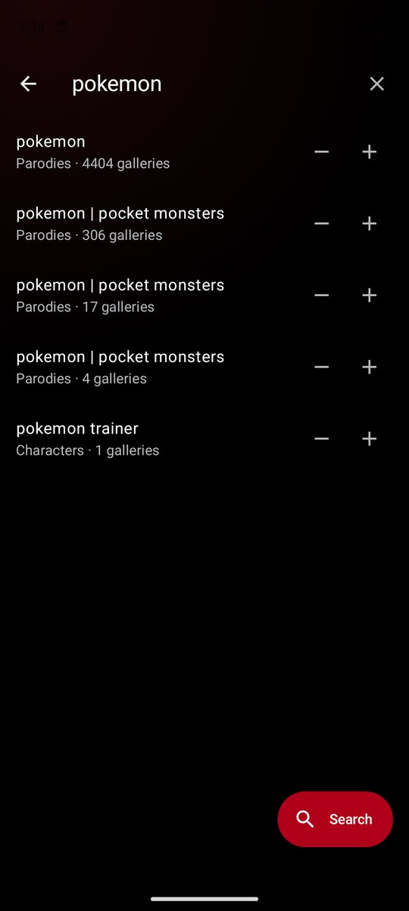
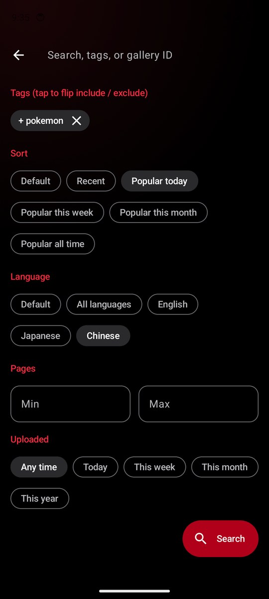
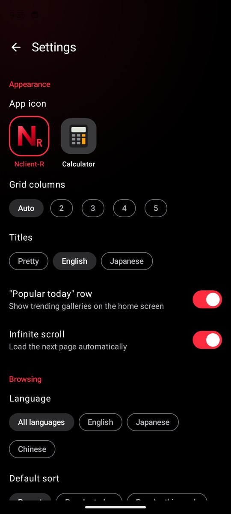

**[Website](https://mayberoker.github.io/Nclient-R/)** · **[Download](https://github.com/mayberoker/Nclient-R/releases/latest)** · **[Request a feature](https://github.com/mayberoker/Nclient-R/issues/new?template=feature_request.yml)** · **[Report a bug](https://github.com/mayberoker/Nclient-R/issues/new?template=bug_report.yml)**

---

## The torch has been passed

**NClientV2** started it. **NClientV3** kept it alive.

**Nclient-R is that next chapter.** It's not a patch and not a fork with a fresh coat of paint. It's a **ground-up rewrite** in modern Kotlin and Jetpack Compose that keeps everything you loved about NClient, then goes further: a pitch-black liquid-glass interface, a reader that never buffers, every tag nhentai has at your fingertips, and a one-tap import that brings your NClientV3 library with you.

> Made by **Roker**. Actively developed. Your ideas shape what comes next.

---

## ✨ Why Nclient-R

| | |
|---|---|
| 🖤 **Pitch-black liquid glass** | Pure black, frosted white glass and a single red accent. Blurred top bars, a floating glass nav pill, rounded everything. Beautiful on OLED, easy on the battery. |
| ⚡ **Zero-buffer reader** | Every page is loaded in **original full resolution**, and the whole gallery preloads in the background, nearest pages first. Swipe and it's simply *there*. |
| 🏷️ **Every tag. Three states.** | Browse **~86,000 tags** straight from nhentai's own directory: tags, artists, characters, parodies, groups, languages, categories. Each one is **Include · Neutral · Exclude**. |
| 🔁 **Bring your NClientV3 library** | Import favorites, status lists, history (with the page you stopped on), tag filters and bookmarks from an NClientV3 backup, even a damaged one. |
| 🕶️ **Discreet by design** | PIN + biometric lock, discreet mode (blurred covers, hidden titles), incognito history, hide-from-recents, and a **calculator icon disguise**. |
| 🆓 **Free & open source** | No ads. No tracking. No accounts required. Apache 2.0. |

---

## 📱 Screenshots

<table>
<tr>
<td align="center"> <b>Home</b>: popular today + latest</td>
<td align="center"> <b>One-tap language</b> flags</td>
<td align="center"> <b>Tags</b>: include / exclude</td>
</tr>
<tr>
<td align="center"> <b>Tag autocomplete</b></td>
<td align="center"> <b>Advanced search</b></td>
<td align="center"> <b>Settings</b> + calculator icon</td>
</tr>
</table>
Screenshots taken with <b>Discreet mode</b> on, so covers are blurred and titles hidden.

---

## 🧩 Every feature

### Browse
- **Home feed** with a *Popular today* carousel and infinite scroll of the latest uploads
- **Sort** by Recent, Popular today, this week, this month or all time
- **Language flags** in the top bar: 🌐 all, 🇬🇧 English, 🇯🇵 Japanese, 🇨🇳 Chinese
- **Jump to any page**, pull to refresh, random gallery button
- **Long-press any cover** to favorite it instantly

### Search
- Search by text, **tags, artists, parodies, characters, groups**
- **Live autocomplete** from the full tag database
- **Include *and* exclude** tags in the same search (tap a chip to flip it)
- Filter by **page count** and **upload date** (today, week, month, year)
- Type a **gallery number** to open it directly
- **Save any search** as a bookmark

### Tags
- The complete nhentai tag directory, by type, sorted by popularity or A–Z
- **Include · Neutral · Exclude** for every tag. Included tags are required everywhere, excluded tags vanish everywhere
- Choose how excluded tags behave: **hide from searches**, hide from lists, or blur the cover
- The home feed refreshes automatically when you change a tag

### Gallery page
- Cover, all titles (English / Japanese / pretty), pages, favorites, upload date
- Tags grouped by type: tap to search, long-press to include, exclude or copy
- Full page-thumbnail grid: tap any page to start there
- **More like this**, **comments**, share, open in browser, copy link or title
- **Continue where you left off**

### Reader
- **Four modes**: right-to-left (manga), left-to-right, vertical, webtoon
- **Original full-resolution** pages, pinch-zoom and double-tap zoom up to 5×
- **Whole-gallery preloading**, nearest pages first, with a 2 GB smart cache
- Tap zones, **volume-key page turning**, page slider, immersive full screen
- Keeps the screen awake, remembers your page automatically

### Library
- **Local favorites** + **online favorites** (with your nhentai API key), and a random favorite button
- **Import all online favorites** to your device in one tap
- **History** with progress bars and one-tap resume
- **Downloads** that run in the background, survive closing the app, resume after reboot, and download several pages at once
- Download a whole gallery or **just a page range**
- **Export downloads to CBZ** (with ComicInfo) **or PDF**

### Privacy & security
- **PIN lock** with **fingerprint / face unlock**
- **Discreet mode**: blur every cover and hide titles in lists
- **Incognito mode**: nothing goes into history
- **Hide in recents**: blocks screenshots and blanks the app preview
- **Calculator disguise**: the launcher icon and name become "Calculator"

### Data
- **Backup & restore** everything: favorites, history, bookmarks, tag filters
- **Import from NClientV3**: favorites, status lists, history + resume pages, tag filters, bookmarks
- **Export for NClientV3** too, if you ever need to go back
- Opens **nhentai links** shared from your browser or other apps

### Built right
- Kotlin · Jetpack Compose · Material 3 · Room · WorkManager · OkHttp · Coil 3
- Image-mirror failover, Cloudflare verification built in, tiny ~3 MB APK
- **Built-in update checker**: you'll know the moment a new version drops

---

## 📥 Install

1. Download **`Nclient-R-v1.0.0.apk`** from the **[latest release](https://github.com/mayberoker/Nclient-R/releases/latest)**.
2. Open it on your phone. If asked, allow *Install unknown apps* for your browser or file manager.
3. Done. Nclient-R will tell you inside the app whenever an update is out.

> Requires **Android 8.0 or newer**. One universal APK for every device.

### Coming from NClientV3?
1. In NClientV3: **Settings → Export**, and save the `.zip`.
2. In Nclient-R: **More → Import from NClientV3** and pick that file.
3. Your favorites, status lists, history, tag filters and bookmarks are now in Nclient-R.

If your favorites live on your nhentai account: **More → Account** (paste your API key), then **Favorites → ⋮ → Import online favorites**.

---

## 💡 Your ideas build the next version

Nclient-R is actively developed and **every request is welcome**: big features, small polish, anything.

- 🚀 **[Request a feature](https://github.com/mayberoker/Nclient-R/issues/new?template=feature_request.yml)**
- 🐞 **[Report a bug](https://github.com/mayberoker/Nclient-R/issues/new?template=bug_report.yml)**
- ⭐ **Star the repo.** It helps other NClient users find the app.

You can also reach both links from inside the app: **More → Request a feature / Report a bug**.

---

## ❓ FAQ

**Is this an official nhentai app?**
No. Nclient-R is an unofficial, independent client and isn't affiliated with nhentai.

**Is it safe?**
It's fully open source: every line is in this repository. No ads, no analytics, no trackers.

**Why does it use a lot of data?**
To make reading instant, Nclient-R preloads whole galleries in full resolution. You can turn that off in **Settings → Reader → Preload whole gallery**.

**My NClientV3 backup won't import.**
Export a fresh backup from NClientV3 and pick it straight from your phone's storage. Nclient-R recovers what it can even from damaged files. If something's still missing, [open a bug report](https://github.com/mayberoker/Nclient-R/issues/new?template=bug_report.yml).

**Is it really the successor to NClientV3?**
NClientV3 is no longer maintained. Nclient-R picks up where it left off, with every NClient feature you rely on, rebuilt for today's Android, plus a lot more.

---

## 🙏 Credits

Nclient-R stands on the shoulders of **[NClientV2](https://github.com/Dar9586/NClientV2)** by Dar9586 and **[NClientV3](https://github.com/maxwai/NClientV3)** by maxwai and its contributors. Thank you for lighting the way. The community tag list comes from the NClientV3 project.

## ⚖️ License & disclaimer

Licensed under the **[Apache License 2.0](LICENSE)**.
This app is intended for **adults (18+)** only. It's an unofficial client and doesn't host any content; everything is loaded from the original website. Use it in accordance with your local laws.

 
 
<b>Nclient-R</b>: made by <b>Roker</b> 
NClient · NClientV3 successor · nhentai client for Android · Nclient APK

